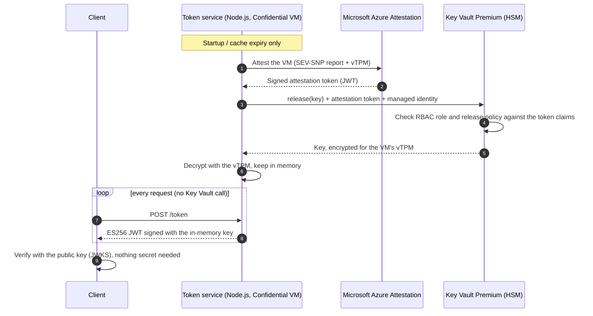

# Sign tokens with a Key Vault key — without signing in Key Vault

> [!CAUTION]
> ## ⚠️ DEMO ONLY — NOT FOR PRODUCTION ⚠️
>
> This repository is a **demonstration**. It is provided **as is**, **without any support, warranty or
> maintenance**, and it is **not designed, hardened or reviewed for production use**.
>
> - Do **not** deploy it in a production subscription or reuse its code for real workloads without your own security review.
> - Known demo shortcuts: the service runs as **root**, endpoints (including `/logs`) are **unauthenticated**, the
>   traffic is plain **HTTP**, Key Vault **purge protection is off**, and the release policy is not pinned to a
>   specific VM measurement.
> - The Secure Key Release helper is a patched build of a Microsoft sample, not a supported product.
> - Deploying it creates billable Azure resources (Confidential VM, Premium Key Vault). **You are responsible for
>   the costs** and for deleting the resources afterwards.
> - No issue triage, fixes or answers are promised.

Signing every token with a Key Vault `sign` call does not scale: each request pays a network round trip and
counts against Key Vault's [service limits](https://learn.microsoft.com/azure/key-vault/general/service-limits).

This demo shows the alternative: **export the private key once, keep it in memory, sign locally**. Key Vault
stays the source of truth and the gatekeeper, because the key is created *exportable* with a **release policy**
(Secure Key Release, SKR) that only lets it leave the vault toward an attested **confidential VM**.



## What gets deployed

| Resource | Purpose |
| --- | --- |
| Key Vault **Premium** (RBAC) | HSM-backed keys are required for Secure Key Release |
| Key `token-signing-key` | EC-HSM P-256, `exportable: true`, with a **release policy** |
| Azure Attestation provider | Issues the attestation tokens trusted by the release policy |
| User-assigned managed identity | Holds *Key Vault Crypto Service Release User*, scoped to the key (release only, no sign/get) |
| Confidential VM (AMD SEV-SNP, Ubuntu 22.04) | Runs the token service; the only place the key can be released to |
| VNet, NSG, public IP | NSG opens 22 and 8080 **only to your IP** |

### The release policy

```json
{
  "version": "1.0.0",
  "anyOf": [{
    "authority": "https://<your-provider>.<region>.attest.azure.net",
    "allOf": [
      { "claim": "x-ms-isolation-tee.x-ms-attestation-type",   "equals": "sevsnpvm" },
      { "claim": "x-ms-isolation-tee.x-ms-compliance-status", "equals": "azure-compliant-cvm" }
    ]
  }]
}
```

Key Vault releases the key only if the attestation token (1) was issued by *this* attestation provider and
(2) proves an Azure-compliant AMD SEV-SNP confidential VM. A stolen managed identity used from anywhere else
(a laptop, a regular VM) cannot obtain the key. The policy is immutable once the key is created.

Hardening ideas: also pin `x-ms-sevsnpvm-launchmeasurement` (the exact firmware/image) or a custom attestation
policy, add `x-ms-sevsnpvm-is-debuggable`, and enable Key Vault purge protection.

## Why this cannot run on a laptop

Key Vault refuses to release the key without an attestation token that proves a trusted execution environment.
A workstation cannot produce one, and custom attestation authorities must chain to a public CA, so there is no
local mock. The service therefore runs on the confidential VM; the **client** runs anywhere.

## Prerequisites

- Azure subscription with quota for **DCasv5** (AMD SEV-SNP) VMs in your region (`westeurope` by default;
  check with `az vm list-skus --location westeurope --size Standard_DC --query "[?name=='Standard_DC2as_v5']"`).
- Azure CLI (`az login`), logged in with permission to create resources and role assignments (Owner, or
  Contributor + User Access Administrator).
- `ssh-keygen` and Node.js 20+ on your machine (the client has no dependencies).

## Run the demo

```powershell
./scripts/deploy.ps1                 # or: ./scripts/deploy.sh
```

Wait ~10 minutes in total (infrastructure, then Node.js install and attestation-helper build on the VM). Then:

```bash
node client/demo.js http://<vm-ip>:8080 --vault <vault-name> --key token-signing-key --tokens 200
```

The script prints the exact command. The client:

1. downloads the **public** key as a JWKS from the service;
2. checks it has the same thumbprint as the public key *in Key Vault* (proves the service signs with the vault key);
3. requests 200 tokens, verifies each one **locally with the public key only**;
4. tampers with a token and shows it is rejected;
5. prints `/stats`: 200 tokens signed, **1** key release call to Key Vault, then the key events from `/logs`.

### Web UI

The service also serves a single-page UI at its root: open `http://<vm-ip>:8080/` in a browser. It is same-origin
(no CORS, no extra infrastructure, nothing to publish separately) and lets you:

- see the service health, `/stats` (signed tokens vs key releases) and the public key (JWKS);
- issue a token (`POST /token`) with a subject and extra claims, and inspect it;
- verify it through the service (`POST /verify`, `GET /protected`), or tamper with the payload first
  (`sub=admin`) to watch the signature check fail;
- follow the live service logs (`GET /logs`).

It is one static file (`app/public/index.html`, no dependencies, no build step) embedded into the VM by cloud-init.
Same caveats as the API: HTTP only, no authentication, reachable only from `allowed_source_ip`.

### Endpoints

`GET /` (web UI), `GET /healthz`, `GET /stats`, `GET /logs`, `GET /.well-known/jwks.json`,
`POST /token` (`{"sub":"alice","claims":{"role":"reader"}}`), `POST /verify` (`{"token":"..."}`),
`GET /protected` (`Authorization: Bearer <token>`).

### Logs

The service logs what it does, as JSON lines on stdout (`journalctl -u token-service -f`) and in an in-memory ring
buffer of the last 1000 entries, served by `GET /logs` (`?limit=100`, `?event=token_issued,key_loaded`,
`?after=<seq>` to follow new entries). Events:

| Event | Meaning |
| --- | --- |
| `http_request` | Method, path, status, duration, remote address (`/logs` itself is not logged) |
| `key_cache_miss` / `key_cache_hit` | The key had to be (re)loaded vs served from memory |
| `skr_release_started` / `_succeeded` / `_failed` | Attestation + Key Vault release + vTPM decryption, with duration |
| `key_loaded` | Key now in memory: `kid`, curve, TTL |
| `token_issued` | Subject, `kid`, `jti`, expiry, names of extra claims (signed with the in-memory key) |
| `token_verified` / `token_rejected` | Result of `/verify` and `/protected`, with the reason |

Tokens, the private key and attestation tokens are never logged. `/logs` is unauthenticated like the other demo
endpoints (the NSG limits access to your IP); protect it before reusing the service for anything real.

Tear everything down (deletes the resource group **and purges** the soft-deleted vault):

```powershell
./scripts/destroy.ps1                # or: ./scripts/destroy.sh
```

> **Cost:** one `Standard_DC2as_v5` VM, a Premium Key Vault with one HSM key and a Standard public IP.
> Roughly a few dollars per day while it runs. Destroy it when you are done.

## Deploy from GitHub Actions

`.github/workflows/deploy.yml` (manual `workflow_dispatch`) deploys or destroys the demo with an `action` input.

Repository secrets to create (Settings → Secrets and variables → Actions):

| Secret | Required | Value |
| --- | --- | --- |
| `AZURE_TENANT_ID` | yes | Entra tenant id |
| `AZURE_SUBSCRIPTION_ID` | yes | Target subscription id |
| `AZURE_CLIENT_ID` | yes | Client id of the app registration / service principal |
| `AZURE_CLIENT_SECRET` | no | Only if you authenticate with a client secret instead of OIDC |
| `SSH_PUBLIC_KEY` | no | Public key for the VM admin user (otherwise a throw-away key is generated and SSH is unavailable) |

OIDC is recommended: add a federated credential on the app registration for this repository and branch,
and leave `AZURE_CLIENT_SECRET` unset. Use issuer `https://token.actions.githubusercontent.com` and audience
`api://AzureADTokenExchange`. The subject must exactly match the `subject claim` printed by the Azure login
step, including any immutable owner/repository IDs (for example,
`repo:<owner>@<owner-id>/<repo>@<repo-id>:ref:refs/heads/<branch>`). A mismatch causes `AADSTS700213`.
Alternatively, set `AZURE_CLIENT_SECRET`; the workflow then uses client-secret authentication instead of OIDC.
The principal needs
**Owner** on the subscription (or Contributor + User Access Administrator) because the template creates role
assignments. Run the workflow with your public IP in `allowed_source_ip`, then use the client command shown in the
run summary. Run it again with `action = destroy` to delete everything and purge the vault.

## Repository layout

```
app/              Zero-dependency Node.js token service (+ unit tests: cd app && npm test)
  lib/jwt.js          ES256 sign/verify, JWK thumbprint
  lib/key-cache.js    In-memory key cache: single-flight refresh, TTL, stale-on-error
  lib/skr-key-provider.js  Calls the Secure Key Release helper
  lib/logger.js       Structured logger + ring buffer behind GET /logs
  public/index.html   Single-page demo web UI served at GET /
client/demo.js    Demo client (runs on your machine)
infra/            Bicep template + cloud-init for the VM
tools/build-skr.sh  Builds Microsoft's AzureAttestSKR helper (pinned commit)
scripts/          deploy / destroy (PowerShell and Bash)
.github/workflows/deploy.yml  GitHub Actions deploy / destroy
```

## How the key is exported

Calling `release` on Key Vault is not a plain REST call: the request must carry an attestation token whose
`runtime-data` binds an ephemeral vTPM key, and the response is encrypted to that key. Microsoft's sample helper
[`AzureAttestSKR`](https://github.com/Azure/confidential-computing-cvm-guest-attestation/tree/main/cvm-securekey-release-app)
implements this. It validates the release but does not print the key, so `tools/build-skr.sh` builds a pinned
upstream commit with a one-line patch: when `SKR_PRINT_KEY` is set, the released key is written to stdout.
The Node service reads it from the pipe and keeps it **only in memory** (never on disk). Replace the helper by
your own implementation (or an SDK) in production.

## Operational notes

- **Caching:** the key is refreshed after `KEY_CACHE_TTL_SECONDS` (default 1 h). If a refresh fails the service
  keeps signing with the cached key and retries, so a Key Vault outage does not take signing down.
- **Rotation:** create a new key version, redeploy (or restart the service) to pick it up; `kid` is the RFC 7638
  thumbprint, so verifiers can follow rotations through the JWKS.
- **Service account:** the demo service runs as root because the attestation helper needs `/dev/tpmrm0`. Use a
  dedicated user in the `tss` group in production.
- **Setup logs on the VM:** `/var/log/token-service-setup.log`, `journalctl -u token-service`.

## Status and caveats

The Node service, client and unit tests are exercised locally (`cd app && npm test`, plus the client against a
service backed by a fake key), and the Bicep compiles (`az bicep build`). The full Secure Key Release flow needs
a confidential VM and has **not** been tested end to end. If a deployment misbehaves, check first:

- **Quota / region:** DCasv5 availability (`SkuNotAvailable` or `QuotaExceeded`).
- **Key release denied (`403 Forbidden`):** the role assignment can take a few minutes to propagate. A failed
  release is logged (`warmup_failed`) and retried on the next request. See `journalctl -u token-service`.
- **Policy encoding:** the key's `release_policy.data` is passed as standard base64 of the JSON policy.
